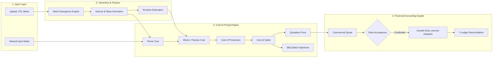

# JobShop Quote Engine
> **Autonomous Cost Engineering, Quotation Generation & Double-Entry Accounting Engine for Additive and Subtractive Manufacturing.**

[](https://www.python.org/)
[](https://streamlit.io/)
[](#accounting-framework)
[](#license)

---

## 📌 Overview
The **JobShop Quote Engine** is a high-precision manufacturing estimation and financial accounting tool designed for custom fabrication workshops (3D printing services, CNC machine shops, and rapid prototyping labs). 

By integrating computational geometry with cost accounting principles, the system eliminates manual calculation errors, accurately absorbs factory overheads, optimizes batch sizes, and automatically executes formal double-entry bookkeeping transactions upon order confirmation.

---

## 🚀 Key Capabilities

### 1. Geometric Parsing & Physical Property Derivation
* Direct parsing of binary and ASCII `.STL` CAD files.
* Deterministic volumetric calculation using discrete surface divergence integration (signed tetrahedra summation).
* Material mass calculation factoring in infill density, material type (PLA, PETG, ABS, Nylon, Aluminum, Steel), and support waste allowances.
* Automated machine run-time estimation based on volumetric deposition rates and layer parameters.
* **Textbook Audit Mode:** Manual parameter override to verify calculations against standard industrial cost accounting reference problems.

### 2. Multi-Tier Hierarchical Cost Sheet
* Computes standard manufacturing cost tiers in accordance with institutional cost accounting standards:
  * **Prime Cost** = Direct Materials + Direct Labour + Direct Tooling Expenses
  * **Works / Factory Cost** = Prime Cost + Factory Overheads (Machine Hour Rate $\times$ Hours)
  * **Cost of Production** = Works Cost + Administration Overheads
  * **Cost of Sales** = Cost of Production + Selling & Distribution Overheads
* Dual-mode profit engine allowing seamless conversion between **Markup on Cost** and **Margin on Selling Price**.

### 3. Economic Batch Quantity (EBQ) Optimizer
* Mathematical optimization of batch production runs for repeat orders:
  $$\text{EBQ} = \sqrt{\frac{2 \times D \times S}{H}}$$
* Evaluates the trade-off between machine setup expenditure ($S$) and inventory carrying/holding costs ($H$).
* Generates an interactive sensitivity table proving total cost minimization where $\text{Setup Cost} \equiv \text{Holding Cost}$.

### 4. Event-Driven Double-Entry Ledger Integration
* Generates an itemized commercial quotation ready for client transmission.
* Interactive **"Accept Order"** trigger that executes real-time double-entry bookkeeping:
  * Posts Journal Entry: `Dr. Sundry Debtors A/c` | `Cr. Sales Revenue A/c`.
  * Generates synchronized T-Accounts with live balance calculation and trial balance reconciliation.

---

## 🏛️ System Architecture



---

## 📐 Mathematical & Accounting Formulations

### 1. Volumetric Surface Divergence
The watertight volume $V$ of an ingested closed triangular surface mesh is calculated via the Divergence Theorem:
$$V = \frac{1}{6} \left| \sum_{i=1}^{N} \vec{v}_{1,i} \cdot (\vec{v}_{2,i} \times \vec{v}_{3,i}) \right|$$
Where $\vec{v}_{1,i}, \vec{v}_{2,i}, \vec{v}_{3,i}$ represent the 3D Cartesian coordinates of the vertices of triangle $i$.

### 2. Multi-Stage Cost Sheet Hierarchy
$$\begin{aligned}
\text{Prime Cost} &= \text{Direct Materials} + \text{Direct Labour} + \text{Direct Tooling} \\
\text{Works Cost} &= \text{Prime Cost} + (\text{Machine Hours} \times \text{Machine Hour Rate}) \\
\text{Cost of Production} &= \text{Works Cost} + \text{Administration Overheads} \\
\text{Cost of Sales} &= \text{Cost of Production} + \text{Selling \& Distribution Overheads} \\
\text{Quotation Price} &= \text{Cost of Sales} \times (1 + \text{Markup Rate})
\end{aligned}$$

### 3. Economic Batch Quantity (EBQ)
$$\text{EBQ} = \sqrt{\frac{2 \times D \times S}{H}}$$
* $D$ = Annual customer demand (units/year)
* $S$ = Setup cost per batch (tool changeover, calibration, slicing verification)
* $H$ = Inventory carrying cost per unit per year

---

## 📂 Project Structure

```
JobShop_Quote_Engine/
├── PRD.md                  # Comprehensive Product Requirements Document
├── BLUEPRINT.md            # Technical Architecture & Implementation Blueprint
├── README.md               # Production Documentation & Setup Guide
├── requirements.txt        # Python package dependencies
├── app.py                  # Main Streamlit Application Entrypoint
├── sample_models/          # Sample .STL files for testing
│   ├── mechanical_bracket.stl
│   └── calibration_cube.stl
└── src/
    ├── __init__.py
    ├── geometry_engine.py  # STL parsing, volume, and runtime derivation
    ├── cost_engine.py      # Cost sheet hierarchy and pricing algorithms
    ├── batch_engine.py     # Economic Batch Quantity optimizer & sensitivity
    └── ledger_engine.py    # Double-entry journal and T-ledger bookkeeping
```

---

## 🛠️ Installation & Setup

### Prerequisites
* Python 3.9, 3.10, or 3.11
* Modern web browser

### 1. Clone & Navigate to Repository
```bash
git clone <repository_url>
cd JobShop_Quote_Engine
```

### 2. Create and Activate Virtual Environment
```bash
python3 -m venv venv
source venv/bin/activate  # On Windows: venv\Scripts\activate
```

### 3. Install Dependencies
```bash
pip install -r requirements.txt
```

### 4. Launch Application
```bash
streamlit run app.py
```
The application will launch automatically in your browser at `http://localhost:8501`.

---

## 🧪 Verification & Benchmark Problems

The engine comes pre-calibrated against standard manufacturing accounting test cases:

### Benchmark 1: Custom Job Quoting (Apex Printers Model)
* **Direct Inputs:** Direct Materials ₹5,000 | Direct Labour ₹3,000 (200 hrs @ ₹15/hr) | Direct Expenses ₹1,000.
* **Overheads:** Factory Overhead @ 50% of Direct Labour | Admin & Selling @ 10% of Works Cost.
* **Markup:** 20% on Total Cost.
* **Verified Result:** Prime Cost = ₹9,000 | Works Cost = ₹10,500 | Cost of Sales = ₹11,550 | **Invoice Quote = ₹13,860.00**.

### Benchmark 2: Batch Optimization (EBQ Minimization Model)
* **Parameters:** Annual Demand = 10,000 units | Setup Cost = ₹400/batch | Holding Cost = ₹2/unit/year.
* **Verified Result:** $\text{EBQ} = \mathbf{2,000\text{ units}}$ (Annual Setup Cost ₹2,000 = Annual Holding Cost ₹2,000; Total Annual Cost = ₹4,000 minimum).

---

## 💻 Tech Stack
* **Language:** Python 3.9+
* **CAD Processing:** `numpy-stl` / `trimesh`
* **Numerical Core:** `numpy`, `pandas`
* **Visualization & UI:** `streamlit`, `plotly`
* **Testing:** `pytest`

---

## 📄 License
This project is licensed under the MIT License.
